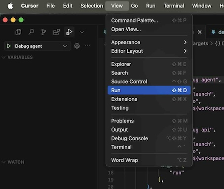
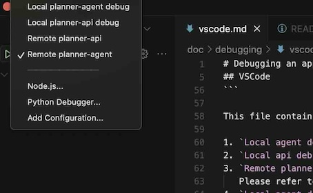

# Debugging an application

This guide will walk you through configuring a debugger for your specific development environment.

## Prerequisites for remote debugging
If you want to execute the remote debugger, please follow the [guide](debug-deployment) to setup the environment with remote debugging enabled.

## VSCode

The `launch.json` file in Visual Studio Code is used to configure debugging settings. It defines how the debugger should start, attach to, or interact with your application.
Please create following file on `.vscode/launch.json`:

```json
{
    "version": "0.2.0",
    "configurations": [
        {
            "name": "Local planner-api debug",
            "type": "go",
            "request": "launch",
            "mode": "auto",
            "program": "${workspaceFolder}/cmd/planner-api/",
            "args": [
                "run"
            ],
            "env": {
                "MIGRATION_PLANNER_MIGRATIONS_FOLDER": "${workspaceFolder}/pkg/migrations/sql"
            }
        },
        {
            "name": "Remote planner-api",
            "type": "go",
            "request": "attach",
            "mode": "remote",
            "port": 40000,
            "host": "127.0.0.1"
        }
    ]
}
```

This file contains two run targets:

1. `Local planner-api debug` - it will compile and run the API locally in debug mode
2. `Remote planner-api` - it will connect to local port 40000
   Please refer to `debugdeployment.md` to setup OpenShift instance in debug mode.

For agent development and debugging, open a separate checkout of [assisted-migration-agent](https://github.com/kubev2v/assisted-migration-agent) and follow its instructions.


### Run the target
In order to run any of the target you need select the target as shown in following image



Then select a specific target and hit F5 to run it:


